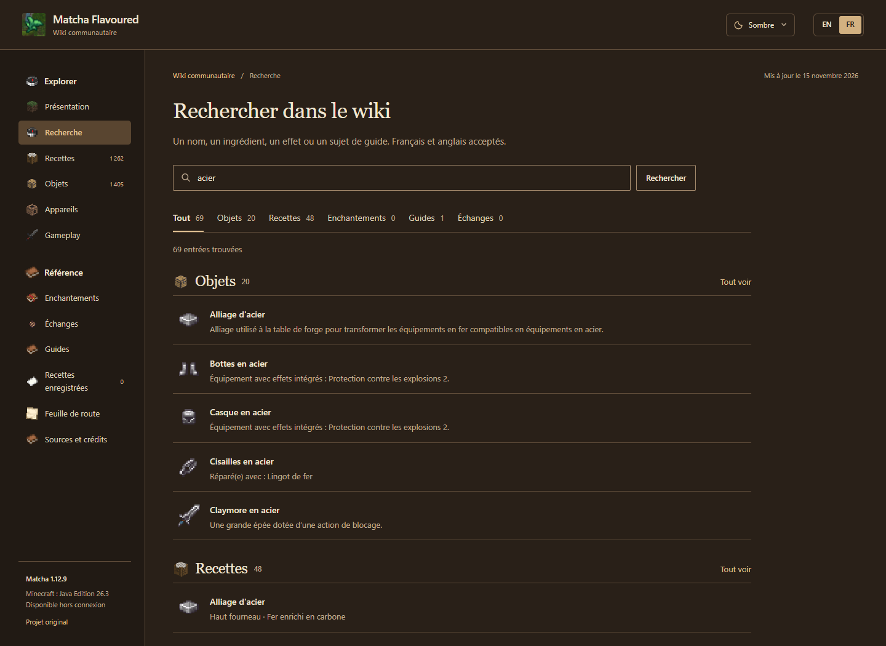

  

# Matcha Flavoured Wiki

**Nouveau wiki réalisé par Tsumun.** Un wiki communautaire en français et en anglais pour retrouver les recettes, comprendre les objets et consulter les règles de Matcha Flavoured.

**[Consulter le wiki](https://tsumundev.github.io/Matcha-Flavoured-Wiki/)** · **[Télécharger le wiki en ZIP](https://github.com/TsumunDev/Matcha-Flavoured-Wiki/raw/refs/heads/main/matcha-wiki-site.zip)** · **[Historique des sauvegardes](https://github.com/TsumunDev/Matcha-Flavoured-Wiki/commits/main/)**

Ce dépôt conserve les versions consultables du wiki et une trace de son évolution. Le fichier HTML, les images nécessaires et le téléchargement hors connexion sont sauvegardés ici. Les sources de travail séparées, outils de développement et archives complètes du pack restent hors du dépôt.

## Le projet original

**Matcha Flavoured est créé par Klei Wright et les contributeurs du projet.** Ce wiki est indépendant et ne constitue pas un wiki officiel du pack.

- **[Matcha Flavoured sur Modrinth](https://modrinth.com/datapack/matcha-flavoured)** : télécharger le pack, consulter sa présentation et ses versions.
- **[GitHub officiel de Matcha Flavoured](https://github.com/kleiwright/matcha-flavoured)** : retrouver les sources et le développement du datapack.

Le wiki sert à consulter des informations. Pour installer ou mettre à jour Matcha, utilisez les pages officielles ci-dessus.

## Version documentée

| Référence | Cette sauvegarde |
| --- | --- |
| Matcha Flavoured | **1.12.9** |
| Minecraft | **Java Edition 26.3** |
| Langues du wiki | **Français et anglais** |
| Édition | **15 novembre 2026** |

Le contenu correspond à cette version précise. Un serveur, un addon ou une autre version du pack peut modifier les règles et les recettes.

## Ce qu’on peut consulter

| Rubrique | Contenu |
| --- | --- |
| Recettes | **1 262 recettes**, avec ingrédients, variantes acceptées, quantités, disposition et appareil. |
| Objets | **1 405 fiches publiques**, avec descriptions, fabrication et utilisations. |
| Guides | **19 guides bilingues** : débuts, cuisine, équipement, santé, mort, créatures, Nether, End, agriculture et exploration. |
| Enchantements | **74 effets actifs** et **28 livres**, dont les bénédictions et Ofuda. |
| Alimentation | **191 aliments et préparations**, avec les effets et les conditions de soin. |
| Échanges | **268 offres utiles**, avec coûts, métiers et conditions de biome lorsqu’elles existent. |
| Progrès et raretés | Un arbre de **69 progrès publics**, les étoiles de **47 poissons** et les raretés de noms documentées. |

La recherche accepte les noms français et anglais, les accents, les identifiants et les alias. Les catégories et filtres se combinent. Trois apparences sont disponibles : Sombre, Clair et Claude. Les recettes enregistrées restent dans le navigateur de chaque lecteur.

Les secrets explicites et entrées de débogage ne sont pas présentés dans cette édition.

## Télécharger et ouvrir hors connexion

1. Téléchargez **[matcha-wiki-site.zip](https://github.com/TsumunDev/Matcha-Flavoured-Wiki/raw/refs/heads/main/matcha-wiki-site.zip)**.
2. Décompressez l’archive dans un dossier.
3. Ouvrez **`index.html`** dans votre navigateur.

Les données, images et recherches sont intégrées au HTML. Aucun serveur ni compte n’est nécessaire pour consulter le wiki ; seuls les liens externes demandent Internet. Les fichiers de crédits accompagnent l’archive.

Le bouton **Code → Download ZIP** de GitHub télécharge quant à lui tout le dépôt, avec le README et l’historique éditorial de cette édition.

## Suivre les sauvegardes

- [CHANGELOG.md](CHANGELOG.md) décrit les évolutions du wiki.
- [SNAPSHOT.json](SNAPSHOT.json) indique la version documentée et les empreintes des fichiers distribués.
- L’[historique Git](https://github.com/TsumunDev/Matcha-Flavoured-Wiki/commits/main/) conserve les versions successives des fichiers.

La revue documentaire du 15 novembre 2026 a comparé les **1 262 recettes** aux sources et ouvert toutes les fiches publiques au navigateur. **30 contrôles navigateur** ont été réussis, notamment pour les recherches, filtres, langues, thèmes, mobile et fonctionnement hors connexion. Cela ne remplace pas une validation en jeu ni le contrôle de chaque configuration serveur.

## Crédits et conditions de réutilisation

Le wiki est réalisé par **Tsumun**. Matcha Flavoured, ses textures et ses contenus appartiennent à **Klei Wright et aux contributeurs crédités**. Le catalogue communautaire d’[Evansch0](https://github.com/Evansch0/MatchaFlavouredWiki) a également servi de référence.

Les contenus Matcha et les adaptations documentaires conservent leurs conditions **CC BY-NC-SA 4.0**. Les noms et ressources Minecraft appartiennent à Mojang Studios et Microsoft. Le fichier de licence GPLv3 choisi à l’initialisation du dépôt ne remplace pas les conditions des éléments tiers.

Voir [ATTRIBUTIONS.md](ATTRIBUTIONS.md), [CONTENT-LICENSE.md](CONTENT-LICENSE.md) et [LICENSE](LICENSE). Ce projet n’est pas affilié à Mojang ou Microsoft.

---

<strong>English</strong>

**New wiki created by Tsumun.** This independent community wiki documents Matcha Flavoured **1.12.9** for Minecraft Java **26.3**, in English and French.

**[Read the wiki](https://tsumundev.github.io/Matcha-Flavoured-Wiki/)** or **[download the offline ZIP](https://github.com/TsumunDev/Matcha-Flavoured-Wiki/raw/refs/heads/main/matcha-wiki-site.zip)**, extract it and open `index.html`. Search, images and data work offline. External links require an internet connection.

This repository preserves browsable snapshots and their history. It contains 1,262 recipes, 1,405 public item entries, 19 guides, 74 active effects, 28 books, 191 foods, 268 trade offers and 69 public advancements. Development files and full pack archives are kept outside this repository.

Matcha Flavoured is created by **Klei Wright and contributors**. Please use **[the official Modrinth project](https://modrinth.com/datapack/matcha-flavoured)** to download the pack and **[the official Matcha GitHub repository](https://github.com/kleiwright/matcha-flavoured)** for its development. This wiki is unofficial.

See [ATTRIBUTIONS.md](ATTRIBUTIONS.md) and [CONTENT-LICENSE.md](CONTENT-LICENSE.md) for the original creators and reuse conditions. Source-file and browser verification do not constitute an in-game test.

