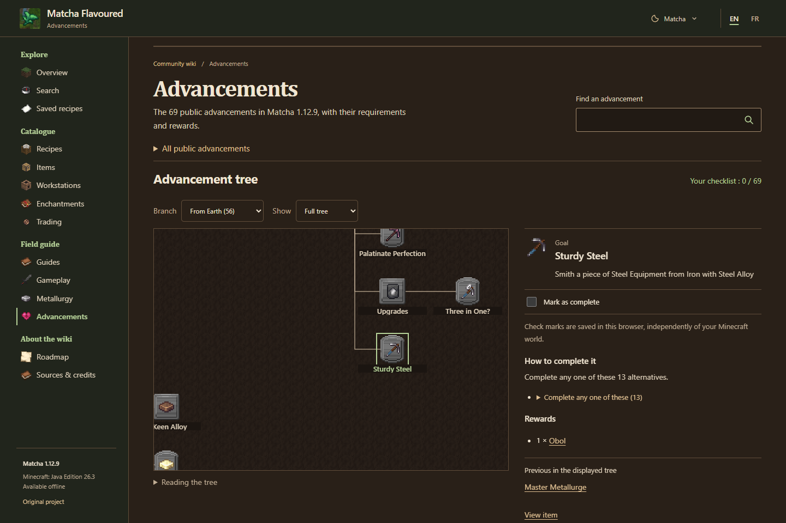
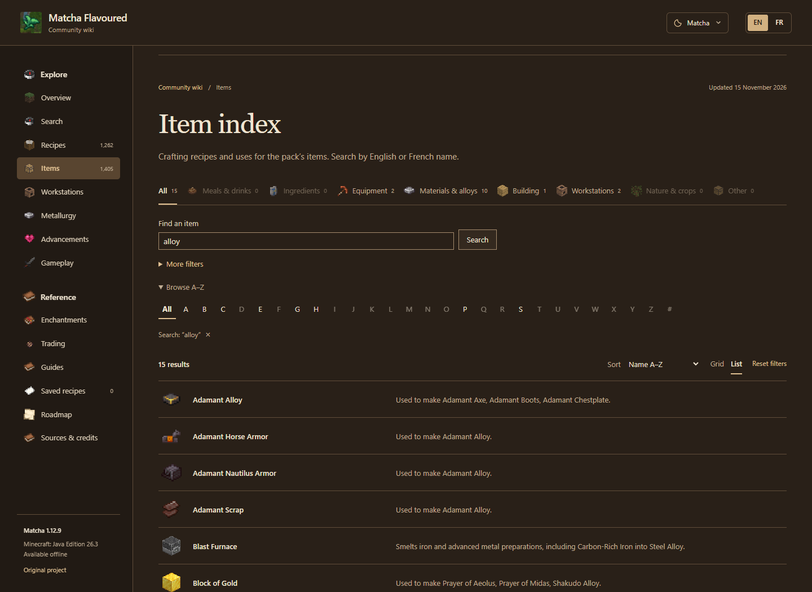

  

# Matcha Flavoured Wiki

**New wiki created by Tsumun.** An independent community wiki to look up recipes, understand items and explore the gameplay changes in Matcha Flavoured. The wiki itself is available in **English and French**.

**[Read the wiki](https://tsumundev.github.io/Matcha-Flavoured-Wiki/#home?lang=en)** · **[Download the offline ZIP](https://github.com/TsumunDev/Matcha-Flavoured-Wiki/releases/latest/download/matcha-wiki-site.zip)** · **[Dated snapshots](https://github.com/TsumunDev/Matcha-Flavoured-Wiki/releases)**

If you find the wiki useful, please leave a **⭐ on this repository**. Thank you for supporting the project!

This repository preserves browsable wiki snapshots and a record of their development. It includes the standalone HTML, its images and an offline download. Separate development sources, tools and full pack archives are kept outside this repository.

[Browse the wiki](#browse-the-wiki) · [Read offline](#download-and-read-offline) · [Updates](#whats-next) · [Credits](#credits-and-reuse)

## The original project

**Matcha Flavoured is created by Klei Wright and the project's contributors.** This wiki is a separate community project and is not an official Matcha wiki.

- **[Matcha Flavoured on Modrinth](https://modrinth.com/datapack/matcha-flavoured)** — download the pack, read its description and browse its releases.
- **[Official Matcha Flavoured GitHub](https://github.com/kleiwright/matcha-flavoured)** — find the datapack's source and development history.

To install or update Matcha, use the official project pages above. This repository distributes the wiki, not the pack.

## Documented version

| Reference | This snapshot |
| --- | --- |
| Matcha Flavoured | **1.12.9** |
| Minecraft | **Java Edition 26.3** |
| Wiki languages | **English and French** |
| Edition date | **15 November 2026** |

The content documents this specific release. Servers, addons and other pack versions may change recipes or gameplay rules.

## Browse the wiki

| What you need | Open | What you'll find |
| --- | --- | --- |
| Start a world | [First steps](https://tsumundev.github.io/Matcha-Flavoured-Wiki/#guide?id=first-steps&lang=en) | Progression help, alongside **19 bilingual guides**. |
| Craft an item | [Recipe index](https://tsumundev.github.io/Matcha-Flavoured-Wiki/#recipes?lang=en) | **1,262 recipes**, accepted alternatives, quantities and workstations. |
| Look up an item | [Item index](https://tsumundev.github.io/Matcha-Flavoured-Wiki/#items?lang=en&view=list&sort=az) | **1,405 entries**, A–Z browsing, crafting recipes and uses. |
| Work with metals | [Metallurgy](https://tsumundev.github.io/Matcha-Flavoured-Wiki/#metallurgy?lang=en) | Ore processing, **five alloy families**, smithing, repairs and **eight pickaxes** compared. |
| Understand healing | [Cooking and food](https://tsumundev.github.io/Matcha-Flavoured-Wiki/#guide?id=cooking&lang=en) | **191 foods and preparations**, effects and healing conditions. |
| Check an enchantment | [Books and effects](https://tsumundev.github.io/Matcha-Flavoured-Wiki/#enchantments?lang=en) | **74 active effects** and **28 books**, including Blessings and Ofuda. |
| Find a trade | [Villager offers](https://tsumundev.github.io/Matcha-Flavoured-Wiki/#trades?lang=en) | **268 offers**, costs, professions and biome conditions. |
| Follow progression | [Interactive advancements](https://tsumundev.github.io/Matcha-Flavoured-Wiki/#advancements?lang=en) | **69 public advancements**, **279 completion criteria**, genuine pack icons, rewards and a local checklist. |
| Check rarity | [Rarity and stars](https://tsumundev.github.io/Matcha-Flavoured-Wiki/#guide?id=rarities&lang=en) | Star ratings for **47 fish** and documented item-name rarities. |

### Follow a goal, then open its recipe

The [advancement page](https://tsumundev.github.io/Matcha-Flavoured-Wiki/#advancements?lang=en) reproduces all three public branches with the original Matcha icons and frame textures. Select a node to see what actually completes it: crafting, inventory, fishing, trading or another trigger. Conditions distinguish **any one** alternative from **every** required step. Tree connections describe the layout, not automatic prerequisites.

You can search all 69 advancements, open related recipes and mark completed goals. The checklist stays in your browser; it does not connect to your Minecraft world.

The [metallurgy guide](https://tsumundev.github.io/Matcha-Flavoured-Wiki/#metallurgy?lang=en) explains the route from raw materials to compatible equipment. It covers Hepatizon, Shakudo, steel, Electrum and Adamant, including the intermediate step for steel and the templates required by specialized tools. Processing times, ingredients and comparison tables link to the actual recipes.

### Finding something faster

- **Continue by scrolling.** At the end of a normal section, keep scrolling to enter the next one; the address and sidebar follow. Scroll upward from the beginning to return to the previous section. Individual guides also continue into the next article.
- **Search in either language.** Names, accents, technical identifiers and aliases work. Try [Steel Alloy](https://tsumundev.github.io/Matcha-Flavoured-Wiki/#items?lang=en&item=minecraft%3Aresin_brick) to open an item directly.
- **Browse by letter.** The item index has an A–Z navigator. Available letters and category counts update for your filters.
- **Choose your view.** Switch between the item grid and a compact list, or sort names A–Z / Z–A. Recommended order puts exact search matches first.
- **Keep useful filters.** Open **More filters** for workstations, item types or rarity. Remove one active filter at a time, or reset the filters while keeping your display choice.
- **Share the right entry.** Item and recipe details include a copy-link button. Item links can keep the current index filters and view.

Preview the item index

The wiki opens in English by default; use **FR** to switch to French. Matcha (the default) and Light appearances are available, and saved recipes stay in each reader's browser. If a result seems missing, clear the selected letter and filters first.

Explicit secrets and debug entries are excluded from this edition.

## Download and read offline

1. Download **[matcha-wiki-site.zip](https://github.com/TsumunDev/Matcha-Flavoured-Wiki/releases/latest/download/matcha-wiki-site.zip)** from the latest published snapshot.
2. Extract the archive into a folder.
3. Open **`index.html`** in your browser.

Data, images and search are bundled into the HTML. No server or account is needed to browse the wiki; only external reference links require an internet connection. Attribution files are included in the archive.

GitHub's **Code → Download ZIP** button downloads the whole repository snapshot instead, including this README and the changelog.

Published snapshots are kept in [Releases](https://github.com/TsumunDev/Matcha-Flavoured-Wiki/releases), so you can return to a dated download. The [current repository copy](https://github.com/TsumunDev/Matcha-Flavoured-Wiki/raw/refs/heads/main/matcha-wiki-site.zip) is also available directly.

## Follow the wiki's progress

- [CHANGELOG.md](CHANGELOG.md) records changes to the wiki.
- [SNAPSHOT.json](SNAPSHOT.json) lists the documented version and distributed file checksums.
- The [Git history](https://github.com/TsumunDev/Matcha-Flavoured-Wiki/commits/main/) preserves successive file versions.

The 15 November 2026 review parsed all **6,570 JSON files** in the two pinned archives, compared **1,262 published recipes** with their sources and checked the public advancement criteria. The metallurgy review traced **65 alloy smithing recipes** and 105 source files. **65 browser checks and five default-language checks passed**, including every public item, recipe, effect and advancement detail, search, local checklists, mobile layouts, scrolling between normal sections and offline use. These are static and browser checks; no in-game testing is claimed.

## What's next

I'll keep updating the wiki over the next few days to improve the index and make navigation as smooth as possible.

## Credits and reuse

The wiki is created by **Tsumun**. Matcha Flavoured and its content and textures belong to **Klei Wright and the credited contributors**. [Evansch0's community catalogue](https://github.com/Evansch0/MatchaFlavouredWiki) was also used as a reference.

Matcha content and documentary adaptations retain their **CC BY-NC-SA 4.0** terms. Minecraft names and vanilla assets belong to Mojang Studios and Microsoft. The GPLv3 file selected when this repository was created does not replace the terms of third-party content.

See [ATTRIBUTIONS.md](ATTRIBUTIONS.md), [CONTENT-LICENSE.md](CONTENT-LICENSE.md) and [LICENSE](LICENSE). This project is not affiliated with Mojang or Microsoft.
