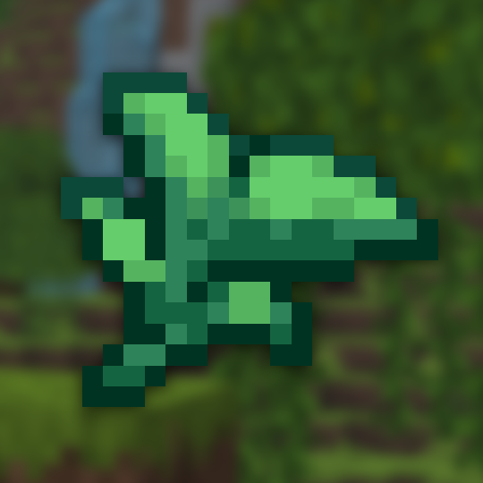

  

# Matcha Flavoured Wiki

**New wiki created by Tsumun.** An independent community wiki to look up recipes, understand items and explore the gameplay changes in Matcha Flavoured. The wiki itself is available in **English and French**.

**[Read the wiki](https://tsumundev.github.io/Matcha-Flavoured-Wiki/)** · **[Download the offline ZIP](https://github.com/TsumunDev/Matcha-Flavoured-Wiki/raw/refs/heads/main/matcha-wiki-site.zip)** · **[Browse saved versions](https://github.com/TsumunDev/Matcha-Flavoured-Wiki/commits/main/)**

If you find the wiki useful, please leave a **⭐ on this repository**. Thank you for supporting the project!

This repository preserves browsable wiki snapshots and a record of their development. It includes the standalone HTML, its images and an offline download. Separate development sources, tools and full pack archives are kept outside this repository.

## The original project

**Matcha Flavoured is created by Klei Wright and the project's contributors.** This wiki is a separate community project and is not an official Matcha wiki.

- **[Matcha Flavoured on Modrinth](https://modrinth.com/datapack/matcha-flavoured)** — download the pack, read its description and browse its releases.
- **[Official Matcha Flavoured GitHub](https://github.com/kleiwright/matcha-flavoured)** — find the datapack's source and development history.

To install or update Matcha, use the official project pages above. This repository distributes the wiki, not the pack.

## Documented version

| Reference | This snapshot |
| --- | --- |
| Matcha Flavoured | **1.12.9** |
| Minecraft | **Java Edition 26.3** |
| Wiki languages | **English and French** |
| Edition date | **15 November 2026** |

The content documents this specific release. Servers, addons and other pack versions may change recipes or gameplay rules.

## What's inside

| Section | Content |
| --- | --- |
| Recipes | **1,262 recipes** with ingredients, accepted alternatives, quantities, arrangements and workstations. |
| Items | **1,405 public entries** with descriptions, crafting recipes and uses. |
| Guides | **19 bilingual guides** covering first steps, cooking, equipment, health, death, creatures, the Nether, the End, farming and exploration. |
| Enchantments | **74 active effects** and **28 books**, including crafted Blessings and traded Ofuda. |
| Food | **191 foods and preparations**, with effects and conditional healing explained. |
| Trading | **268 useful offers**, with costs, professions and biome conditions where applicable. |
| Advancements and rarity | A tree of **69 public advancements**, star ratings for **47 fish** and documented item-name rarities. |

Search accepts English and French names, accents, technical identifiers and aliases. Categories and filters can be combined. Dark, Light and Claude appearances are available, and saved recipes stay in each reader's browser.

Explicit secrets and debug entries are excluded from this edition.

## Download and read offline

1. Download **[matcha-wiki-site.zip](https://github.com/TsumunDev/Matcha-Flavoured-Wiki/raw/refs/heads/main/matcha-wiki-site.zip)**.
2. Extract the archive into a folder.
3. Open **`index.html`** in your browser.

Data, images and search are bundled into the HTML. No server or account is needed to browse the wiki; only external reference links require an internet connection. Attribution files are included in the archive.

GitHub's **Code → Download ZIP** button downloads the whole repository snapshot instead, including this README and the changelog.

## Follow the wiki's progress

- [CHANGELOG.md](CHANGELOG.md) records changes to the wiki.
- [SNAPSHOT.json](SNAPSHOT.json) lists the documented version and distributed file checksums.
- The [Git history](https://github.com/TsumunDev/Matcha-Flavoured-Wiki/commits/main/) preserves successive file versions.

The 15 November 2026 documentation review compared all **1,262 recipes** with their release sources and opened every public item, recipe and effect entry in a browser. **30 browser checks passed**, covering search, filters, languages, themes, mobile layouts and offline use. These checks do not replace in-game testing or validation of individual server configurations.

## What's next

I'll keep updating the wiki over the next few days to improve the index and make navigation as smooth as possible.

## Credits and reuse

The wiki is created by **Tsumun**. Matcha Flavoured and its content and textures belong to **Klei Wright and the credited contributors**. [Evansch0's community catalogue](https://github.com/Evansch0/MatchaFlavouredWiki) was also used as a reference.

Matcha content and documentary adaptations retain their **CC BY-NC-SA 4.0** terms. Minecraft names and vanilla assets belong to Mojang Studios and Microsoft. The GPLv3 file selected when this repository was created does not replace the terms of third-party content.

See [ATTRIBUTIONS.md](ATTRIBUTIONS.md), [CONTENT-LICENSE.md](CONTENT-LICENSE.md) and [LICENSE](LICENSE). This project is not affiliated with Mojang or Microsoft.
